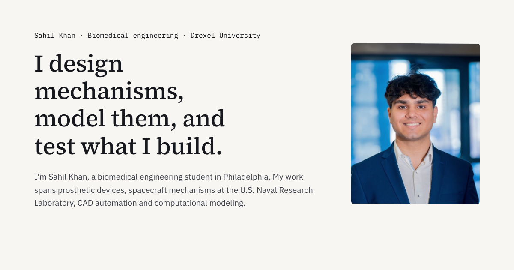

# Sahil Khan · Engineering portfolio

Case studies in prosthetic devices, medical device design, simulation and CAD automation.

**[sahil101905.github.io](https://sahil101905.github.io/)**



## Case studies

| Project | What it covers |
| --- | --- |
| [Tetra-chiral prosthetic lattice](https://sahil101905.github.io/projects/tetra-chiral-prosthetic-lattice/) | Three chiral unit cells designed in SolidWorks, nonlinear FEA, 3D-printed specimens and compression testing against an ASTM control. |
| [Modular prosthetic hand with EMG control](https://sahil101905.github.io/projects/emg-prosthetic-hand/) | A repairable 3D-printed hand with linear actuation, a Raspberry Pi + ATmega32U4 control stack and an EMG intent pipeline. |
| [Negative-pressure isolation helmet](https://sahil101905.github.io/projects/negative-pressure-helmet/) | A $68 prototype traced from six requirements to a Simulink control-volume model and repeated bench verification. |

The site also covers engineering software (NX-to-MATLAB automation, REEF, an FEA platform) and a set of MATLAB/Simulink modeling projects.

## How it's built

- **Next.js + TypeScript**, exported as a fully static site and deployed to GitHub Pages by [a GitHub Actions workflow](.github/workflows/deploy.yml).
- **In-browser CAD viewer.** The case studies load the original SolidWorks STEP files, triangulate them in the browser with [occt-import-js](https://github.com/kovacsv/occt-import-js) (OpenCascade compiled to WebAssembly) and render them with Three.js. See [`components/StepViewer.tsx`](components/StepViewer.tsx).
- Plain CSS with no UI framework. Content lives in [`lib/content.ts`](lib/content.ts).

## Run locally

Requires Node.js 20.9 or newer.

```bash
npm install
npm run dev     # http://localhost:3000
npm run build   # static site in ./out
```

To serve from a sub-path, set `NEXT_PUBLIC_BASE_PATH` (for example `/portfolio`) before building.

## Contact

[LinkedIn](https://www.linkedin.com/in/sahil-k2/) · [Email](mailto:sk4363@drexel.edu)
